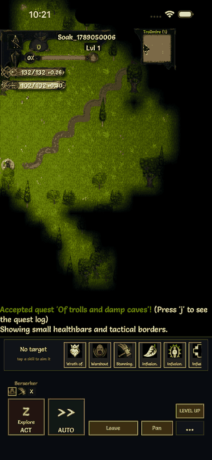
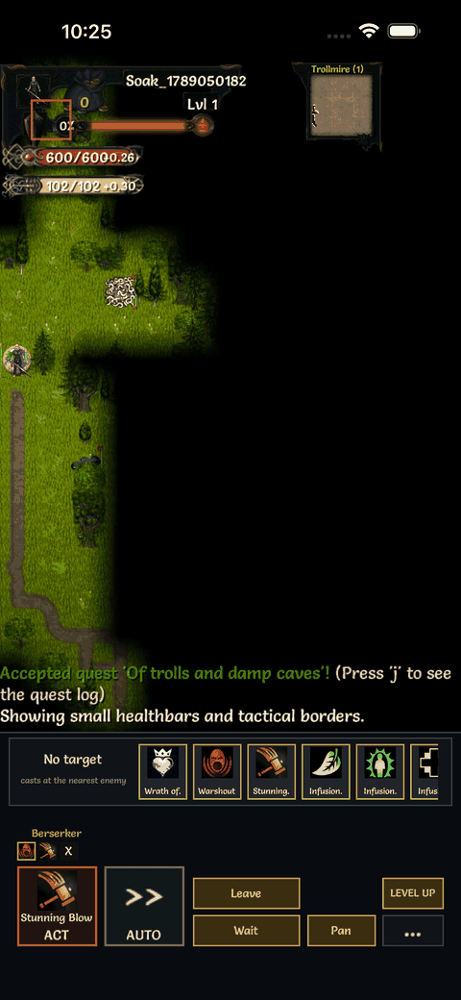
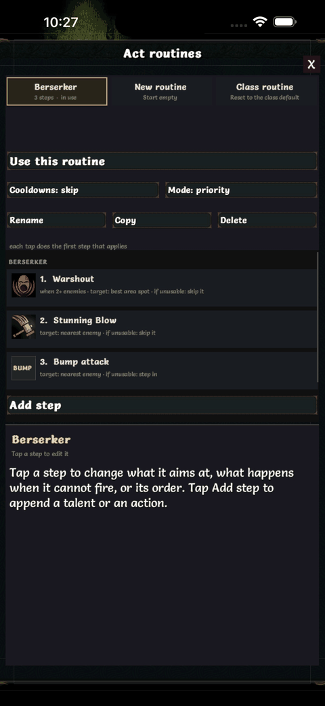
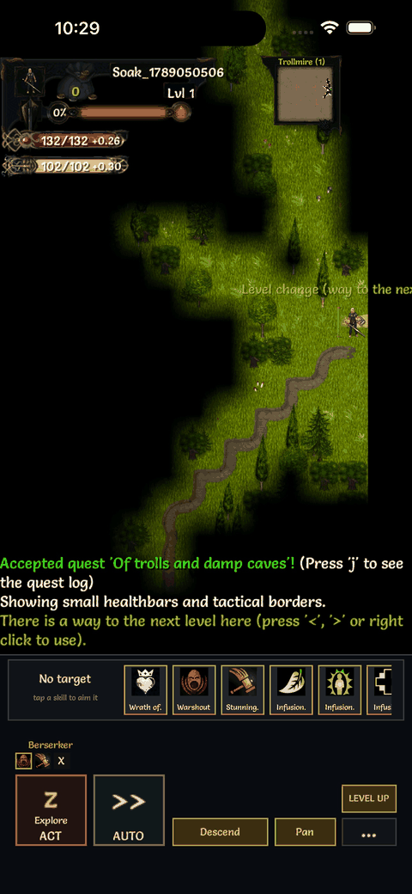
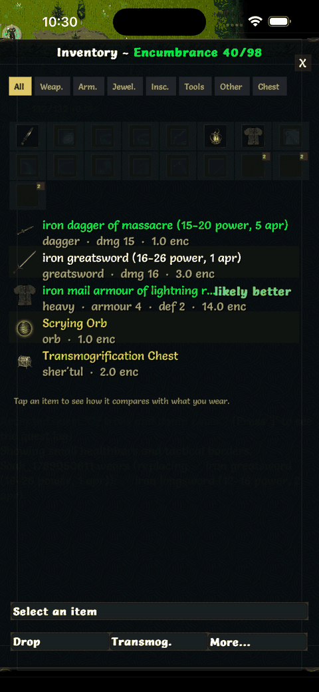
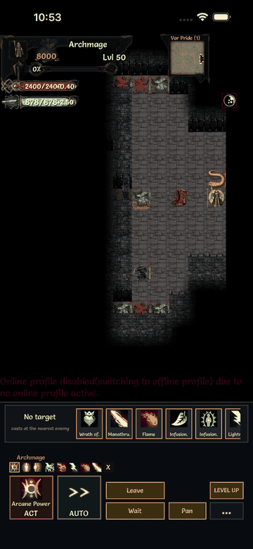
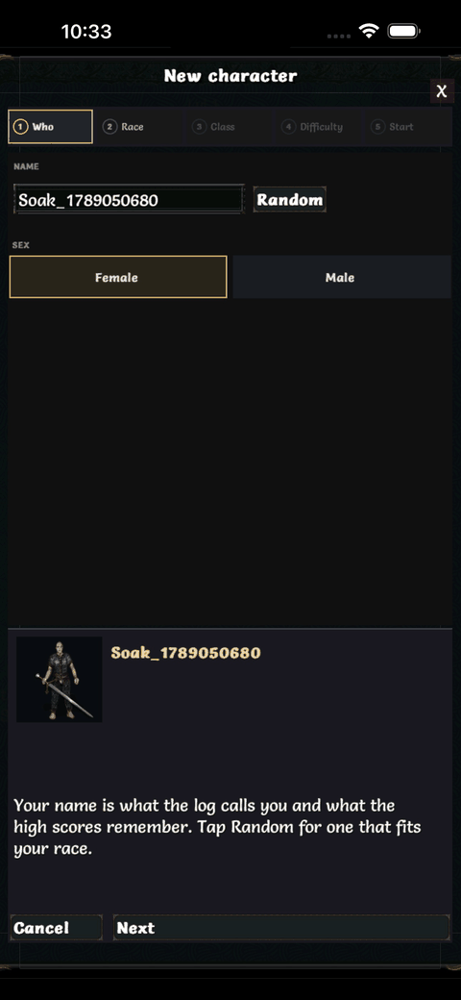

# Tales of Maj'Eyal on iPhone, unofficial

A port of T-Engine4 / Tales of Maj'Eyal 1.7.6 to iOS with an interface built for a phone
held in one hand. It is not a DarkGod project, it is not on the App Store, and it is free:
you build it yourself and sideload it with your own Apple ID. It exists because one player
wanted ToME on the train.

The author does not plan to maintain it and is looking for someone who wants to take it on.

## What the phone version does

| | |
|---|---|
|  | **Moving.** Tap a tile to walk there. Drag on the map and the destination lights up under your finger, release to step, hold still to keep walking. With enemies in view only the drag moves you, so a stray tap never costs a turn. The Pan pill turns a one-finger drag into a camera scroll. |
|  | **Act and AUTO.** Act does the next step of your routine: a bump, a shot, a skill, closing in on its own. AUTO keeps acting and exploring until something needs you: low life, a low resource, an elite in view, a level up, drowning. It asks first if a stop rule already holds. |
|  | **Routines.** A priority list: each tap does the first step that applies. Steps carry a When chip (adjacent, 2+ enemies, life low, target low, no enemies in view, pets below cap), sustains are kept on, and every class starts with a routine built from the way it is played. Cycle mode for fixed combos. |
|  | **Pills.** Descend, Ascend or Enter when you stand on stairs or an exit. Wait with enemies in view. Rest when hurt and alone, running the game's own rest until you tap. Pan whenever AUTO is off. |
|  | **Inventory.** Filter chips, what you wear in a grid at the top with the second weapon set beside it, and every item's description compared against what you have on. Tap a worn slot with an item selected to put it there; drag works too. |
|  | **A raid on AUTO.** A level 50 Archmage inside Vor Pride, AUTO running the class routine against the orc pride. The character comes from `tools/touch/demos/hero-archmage.lua`, which builds a max-level hero in randart gear and saves them at the pride gates (`AP_CLASS=Archmage AP_RACE=Higher` picks the birth). |
|  | **Character creation.** Five steps on one screen, the hero updating as you pick race and class, every race and class unlocked by default (Options → Touch). |

Also: the skill strip always in view with cooldowns, a target ring with the target's life on
the strip, skills aimed by hand unless you picked a target, two-finger tap to go back, pinch to zoom, rotate the
phone at any time, larger text sizes, a classic mode without Act and AUTO, a screen that stays
on and dims while AUTO runs, and a six-page controls guide inside the game.

## Building and installing

Requirements: macOS on Apple silicon, Xcode with the iOS SDK, an Apple ID signed in to Xcode
(a free account works; its builds expire after seven days and need reinstalling).

```
tools/ios/build-deps.sh                 # SDL2, SDL2_image, SDL2_ttf, libpng, ogg/vorbis, LuaJIT: once
tools/ios/install-device.sh             # build, sign, install and launch on the plugged-in phone
PLATFORM=sim tools/ios/build-engine.sh  # a simulator build in tools/ios/out/ToME.app
```

Signing needs your Apple team id (Xcode > Settings > Accounts, or developer.apple.com under
Membership): write it to `tools/ios/team.txt` (ignored by git) or export `APPLE_TEAM`. The Xcode
project carries no team of its own.

The phone must be plugged in, unlocked, and trusting the Mac. `tools/ios/pull-log.sh` copies
the game log and any crash report off the phone.

Music is not in the repository (see Licensing). For a build with music, put the `music` folder
from an official ToME download at `game/modules/tome/data/music/` before building.

## Layout of the port

- `src/`: the engine's C, with an OpenGL ES 1 compatibility layer for its fixed-function
  rendering (`gles1_compat.c`), iOS glue in `main.c`, a crash reporter, the safe area.
- `tools/ios/`: the build pipeline, the Xcode wrapper, the app icon.
- `game/engines/default/engine/TouchInput.lua`: the finger layer. Gestures, the test harness.
- `game/modules/tome/class/TouchManual.lua`: the band, the strip, the pills, Act and AUTO.
- `game/modules/tome/dialogs/Touch*.lua`: every screen redone for the phone.
- `game/modules/tome/class/Player.lua`: routines and AUTO (`act*`, `autoAct*`).
- `tools/touch/`: 96 scripted tests run in the simulator (`sweep-all.sh` runs them all on two
  simulators), and the demo scripts that made the images above (`demos/democap.sh <udid> <name>`
  films one; `demos/hero-archmage.lua` builds the level 50 character used by the raid).
- `brain/wiki/`: the design notes written while building it, section by section.

The branch `ios-core` holds only the platform layer, with no interface treatment, for anyone
who wants to build a different interface on a working port.

## Known issues

- No DLC classes (the port is built from the free source tarball).
- Landscape has the older layout without the bottom band.
- Naming an item has produced a black screen on a phone once; not reproduced in the simulator.
- Free-account builds expire after seven days.

## Licensing

The code is GPL-3 (COPYING); this repository's changes are GPL-3 as well. The graphics under
the game's gfx folders are granted for use with Tales of Maj'Eyal only (COPYING-MEDIA), and
this is Tales of Maj'Eyal, unofficial and free. The music credited in CREDITS (Celestial Aeon
Project, Carlos Saura, Anne van Schothorst, via Jamendo and the Free Music Archive) is not
redistributed here. Sound effects are credited in CREDITS.

Tales of Maj'Eyal and T-Engine4 are by Nicolas Casalini (DarkGod) and the ToME community.
